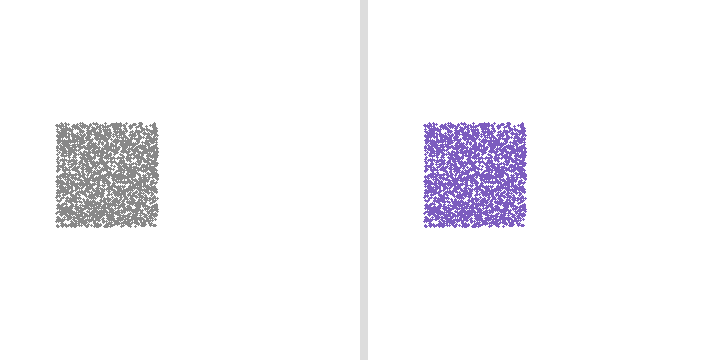
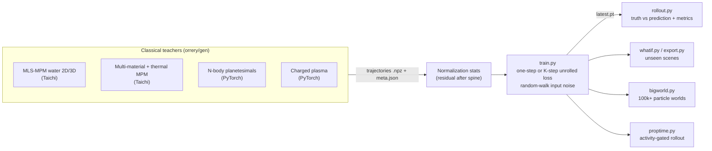

# Orrery

**A neural particle world engine: a ~1.6M-parameter graph network learns interaction laws from classical simulators, then predicts the world tick by tick on a consumer GPU.**

| Gen 1: learned everything (water levitates) | Gen 2: exact gravity injected, network learns the residual |
|---|---|
|  |  |

*Left panel of each: the classical simulator (ground truth). Right panel: the network rolling the same scene forward from its own predictions for 300 frames. Same data, same resolution, same step count; the difference is which part of the physics the network is asked to learn.*

## The idea

A language model keeps the rules of language in its weights and the text in its context. Orrery flips the proportions. Physics has far fewer rules than English, so the weights are tiny (about 1.6M parameters at the defaults), and the *world state* (hundreds of thousands of particles) is what fills VRAM. The scaling axis is world size, not model size: a model trained on 3,000-particle scenes runs unchanged on a ~100,000-particle world because it only ever looks at local neighborhoods.

Three design rules run through the code:

1. **Exact spine, learned residual.** Wherever a law is known exactly (uniform gravity, pairwise N-body gravity, Coulomb forces plus a trap), it is computed analytically (`orrery/spines.py`). The training target has that force subtracted, and rollout adds it back every step. The network only learns what is actually hard: contacts, pressure, plasticity, heat transport. Every injected law is one less thing the network can hallucinate. The GIFs above show this rule at work.
2. **Conservation by construction.** With `--conserve-momentum` the decoder emits one force per *directed edge* and applies `+g` to the receiver and `-g` to the sender, so the network's contributions sum to zero for any weights (Newton's third law as architecture, not as a loss term).
3. **The model is the imagination, not the witness.** A learned simulator can only replay the physics its teacher encoded, plus its own artifacts. Orrery is a fast engine for counterfactuals and what-ifs, not a source of evidence about the real world.

## Architecture



The model (`orrery/model.py`) is a GNS-style encoder / processor / decoder (Sanchez-Gonzalez et al., 2020), written in plain PyTorch with `index_add_` aggregation, so no `torch_geometric` (which keeps it portable to ROCm):

- **Nodes:** the last 5 velocities, normalized, plus the distance to each wall clipped at `wall_clip x R`. Optional extras: temperature history, charge, a material embedding, and a regime embedding (which teacher a sample came from).
- **Edges:** relative displacement / R and distance / R on a radius graph.
- **Processor:** 10 residual message-passing blocks, hidden width 128.
- **Output:** normalized acceleration (plus dT on thermal corpora), integrated with `p_next = 2p - p_prev + a`.

Engine pieces around the model:

- an O(N) hash-grid neighbor search (`data.build_edges_grid`), tested against an exact radius graph
- edge-chunked message passing and an fp16 network for large worlds (particle state and integration stay fp32)
- gradient checkpointing for dense contact frames
- an OOM ladder in the trainer (full batch, then half batch, then skip), which also catches the hipBLAS allocation errors ROCm raises instead of a normal OOM
- per-corpus normalization when one network trains on several teachers at once

## Quickstart

```bash
python -m venv .venv && source .venv/bin/activate
pip install -e ".[mpm,dev]"      # drop "mpm" to skip Taichi (the N-body/plasma teachers are pure torch)

pytest                           # 30 s - 2 min on CPU, fully offline
bash scripts/smoke.sh            # tiny CPU run of every stage -> out/smoke/*.gif (~25 min on a shared 2-vCPU VM)
```

The full-size loop (this needs a GPU; Gen 2 is about 12 h for 200k steps on a 16 GB card):

```bash
python -m orrery.gen.mpm2d --out data/water2d --traj 40 --particles 3000 --frames 400
python -m orrery.train --data data/water2d --out runs/gen2 --steps 200000 \
    --gravity-residual --wall-clip 4.0 --dynamic-frac 0.5 --resume
python -m orrery.rollout --ckpt runs/gen2/latest.pt --data data/water2d \
    --traj 39 --steps 300 --metrics --gif runs/gen2/rollout.gif
python -m orrery.whatif --ckpt runs/gen2/latest.pt --data data/water2d \
    --scene dam_break --gif runs/gen2/dam_break.gif
python -m orrery.bigworld --ckpt runs/gen2/latest.pt --data data/water2d \
    --particles 300000 --fp16 --gif runs/gen2/ocean.gif
```

`scripts/recipes.sh <gen>` holds the corpus and training flags for every generation listed below, including the learning-rate horizon each run used (`--steps`) and the step its checkpoint came from (`--stop-at`). The cloud runs used a 600k-step horizon and were stopped early, and the LR schedule depends on that horizon. Two rows are not reproduced exactly; the script and the table say which. Corpora, checkpoints and run outputs are not in the repo. They are regenerated from the teachers.

## What is measured, and how

**Checked by the test suite (reproducible here, CPU, offline).** `pytest` asserts:

- the hash-grid neighbor search returns exactly the brute-force radius graph, in 2D, in 3D and on wide domains
- the momentum-conserving decoder sums to zero for random weights; edge-chunked inference and gradient checkpointing reproduce the unchunked forward pass and gradients
- the N-body and Coulomb spines match the force laws the teachers integrate, so the "exact" part is the same law
- the spine residual is zero on pure free fall
- in a conserving rollout, the center of mass follows exactly the trajectory implied by the corpus-mean residual (see limitations)
- activity-gated rollout with every particle hot is bit-identical to the full rollout
- teacher, train, resume, rollout and what-if all run end to end
- `train.py --stop-at` stops early while keeping the LR schedule set by `--steps`
- `bigworld.py --fp16` halves the network only; particle positions stay fp32

**Reported historical results (not reproducible from this repo alone).** These came from the runs that `scripts/recipes.sh` records (exceptions noted in the table), between August 2-13, 2026. Training ran on an AMD RX 6800 XT 16 GB (ROCm) desktop GPU and on rented single-GPU cloud instances (NVIDIA RTX 4090 / RTX 3090). All rollouts were evaluated on the RX 6800 XT. Checkpoints are not published.

The metric is **full-rollout position MSE**, as `rollout.py` prints it: the mean squared particle-position error over a 300-frame autoregressive rollout of one held-out trajectory, in unit-domain coordinates. The first 6 seed frames are included. Each number is **one run and one held-out trajectory, with no seeds or error bars**. Different corpora have different scales, so compare numbers only within a row group.

| Experiment | Steps | Result |
|---|---|---|
| Gen 1 water (everything learned) | 200k | MSE 0.0328; water comes to rest well above the floor (left GIF) |
| Input-noise A/B, Gen 1 | 200k each | 6.7e-4 (the GNS paper value): 0.0328, vs 3.35e-4: 0.0478 |
| Gen 2 water (gravity spine + wall-clip 4R + dynamic-frame sampling) | 200k | **MSE 0.0012 (27x lower)**; floor contact restored (right GIF). Three changes landed together, so the 27x is not attributed to any single one. |
| Gen 3 water/jelly/snow, one network, material embedding, 3-step loss | 131k | pure-water holdout 0.00097, mixed-material holdout 0.00195 |
| Gen 4 N-body, free decoder | 95k | MSE 0.021; predicted cloud center of mass sinks -0.125 over 300 frames. Its exact flags were not fully recorded; `recipes.sh gen4free` is the controlled reconstruction, not the original run. |
| Gen 4 N-body, `--conserve-momentum` | 65k | MSE 0.0073; center-of-mass drift 0.0000 to 4 d.p. |
| Gen 5 thermal convection | 74k | MSE 0.00032 |
| Gen 6 3D water | 251k | residual levitation: center of mass +0.029 above truth (down from +0.08 at 98k). Not solved. |
| Gen 9 two-species plasma, conserving | 241k | MSE 0.00054, center-of-mass drift 0.0000 |
| One network on matter + thermal corpora (regime embedding) vs specialists, **pre-fix run** | 96k | per-regime MSE 8x (pure water), 2.4x (mixed), 2x (thermal) worse than the specialists. This run used an earlier `train.py` with *pooled* normalization (one stats dict for both corpora), the defect described in `docs/design.md` as the wall-climb bug, and it also had fewer steps per regime. So it does not measure one-network-vs-specialists interference. The current per-corpus code (`recipes.sh merge`) has no reported result. |

Large-world inference (`bigworld.py`, Gen 1 water checkpoint trained on 3k-particle scenes, RX 6800 XT):

| World | dtype | edges | speed | peak VRAM |
|---|---|---|---|---|
| 98k particles | fp32 | 2.7M | 24.8 steps/s | 7.6 GiB |

Runs at 299k and 598k particles with `--fp16` were also made, but they are not reported here: the version of `bigworld.py` used then stored the particle positions and history in fp16, not only the network inputs. On a domain about 100 units wide, fp16 position spacing is 0.0625, several graph radii, so the per-frame motion rounded away and the neighbor graph was inflated by quantization. `--fp16` now applies to the network only, and the larger worlds have not been re-measured.

Property time (`proptime.py`, measured on CPU) gates updates by activity: particles that are not moving freeze, and a full-graph tick every 8 steps wakes them up. On one settled 2D water scene, with the default thresholds, this gave a **6.14x wall-clock speedup at 27.3% of node updates**. The gated rollout differed from the ungated one by 5e-5 position MSE. That is one scene: the thresholds were not swept, and the GPU behaviour was not measured.

**Limitations, stated plainly**

- Every result above is a single run. There are no confidence intervals, and generations do not share a common benchmark.
- Large-world speed above 100k particles has not been measured with the current code.
- Long rollouts drift. Nothing in the engine corrects predictions back toward a simulator.
- Conservation is exact for the network term only. Denormalization adds the corpus-mean residual acceleration to every particle. That mean is about zero for the symmetric N-body and plasma corpora, but not zero by construction.
- Gen 6 (3D) still levitates slightly. Whether one network trained on several teachers loses accuracy against the specialists has not been measured cleanly (see the pre-fix merge row).
- The cross-scale hierarchy (Gen 8 on the roadmap) has not been started.

## Project status

**Research prototype.** Generations 1-7 and 9 have working first versions (`docs/design.md` has the full roadmap, design notes and decision log). The code runs and is tested. It is not packaged as a library with a stable API, and no trained weights are published.

## Repository layout

```
orrery/
  model.py      GNS encoder/processor/decoder (+ conservation, embeddings, checkpointing)
  data.py       corpus I/O, features, radius graphs (cdist + hash grid), noise, batching
  spines.py     exact forces: uniform gravity, N-body, Coulomb + trap
  train.py      one-step / K-step unrolled training, spines, multi-corpus merge, OOM ladder
  rollout.py    autoregressive evaluation, metrics, truth-vs-prediction GIF
  ckpt.py       checkpoint -> model rebuild shared by every inference tool
  whatif.py     hand-built counterfactual scenes rolled out from the weights
  export.py     bake a what-if to a flat float32 file for replay in another client
  bigworld.py   train-small, run-big inference (hash grid, fp16, chunking)
  proptime.py   activity-gated ("property time") rollout
  gen/          teachers: mpm2d, mpm3d, mpm_multi (+thermal), nbody, charged
scripts/        smoke.sh (CPU end to end), recipes.sh (per-generation flags)
tests/          offline pytest suite
docs/           design notes, roadmap, decision log, media
```

## Configuration

There is no service configuration and there are no secrets. The only environment variables are PyTorch allocator hints (`PYTORCH_CUDA_ALLOC_CONF`, `PYTORCH_HIP_ALLOC_CONF`). `train.py` defaults both to `expandable_segments:True` unless you have already set them. `.env.example` lists them. `scripts/smoke.sh` also reads `PYTHON`, `OUT` and `STEPS`.

## Lineage

The model and training recipe follow the GNS family: one-step acceleration targets, random-walk input noise for rollout stability, and relative-displacement edge features (Sanchez-Gonzalez et al., *Learning to Simulate Complex Physics with Graph Networks*, ICML 2020). The MLS-MPM teachers are adapted from the Taichi examples mpm88 (water, 2D and 3D) and mpm99 (multi-material), which are Apache-2.0 licensed; see `THIRD_PARTY_NOTICES`. The parts of this repo that go beyond the GNS paper are the engine around the model and the experiments: exact-force spines, conservation by construction, one network trained on several teachers, large-world inference on consumer and AMD hardware, and activity-gated time.

## How it was built

Designed by Nick McBride and built with his AI agent Iris (Claude-based) as part of a personal research platform.

## License

MIT. See [LICENSE](LICENSE). The three MLS-MPM teachers (`orrery/gen/mpm2d.py`, `mpm3d.py`, `mpm_multi.py`) are derived from Taichi's Apache-2.0 examples and stay under Apache-2.0; see [THIRD_PARTY_NOTICES](THIRD_PARTY_NOTICES).
